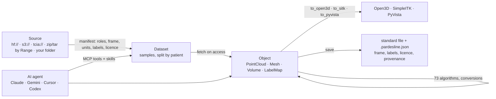
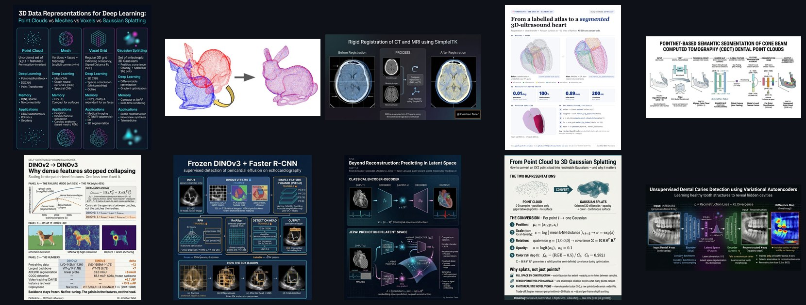

<p align="center">
  
</p>

<h1 align="center">pardesline</h1>

<p align="center"><b>3D vision and medical imaging in one Python package.</b><br>
73 algorithms on point clouds, meshes and volumes · 43 public datasets loadable in one line · Open3D, SimpleITK and PyVista behind one typed object · an MCP server that gives all of it to AI agents.</p>

<p align="center">
<a href="https://pypi.org/project/pardesline/"></a>
<a href="https://pypi.org/project/pardesline/"></a>
<a href="LICENSE"></a>
<a href="https://github.com/pardesline/pardesline/actions/workflows/ci.yml"></a>
</p>

```bash
pip install "pardesline[all]"      # Open3D, PyVista, SimpleITK, Hugging Face, MCP server  (Python 3.10-3.12)
```

```python
import pardesline as pl

ds = pl.load("msd_task02_heart")  # 30 cardiac MRIs; nothing downloaded until you touch a sample
s = ds.filter(split="Tr")[0]  # roles: mri, mask - licence and citation attached
atrium = s.mask.to_mesh(label=1)  # exact left-atrium surface, LPS millimetres
atrium.decimate(target_reduction=0.5).save(
    "atrium.stl"
)  # + atrium.stl.pardesline.json: frame, licence, every step

ct = pl.load("tcia://Pancreas-CT")[0].ct  # a DICOM series from The Cancer Imaging Archive
moved = ct.align(pl.load("day7.nii.gz"))  # rigid registration; moved.transform holds the 4x4
ct.to_sitk()
atrium.to_open3d()
atrium.to_pyvista()  # the libraries you already use, one call away
```

This repository is the PardesLine Python SDK (the `pardesline` package on
PyPI). Everything local is Apache-2.0 and needs no account; the hosted
platform (sharing, GPU, viewers) is an optional client inside it.

## What you can do with it

| | | Read more |
|---|---|---|
| **Load any dataset in one line** | MSD, AMOS, TotalSegmentator, LUNA16, IXI, VerSe, TCIA collections, OpenNeuro, KITTI, Objaverse, Hugging Face repos... 43 manifests. Files are fetched lazily (HTTP Range into 24 GB archives), verified, cached; the licence travels with the data. Your own folder: `pl.scan` asks what it cannot know, never guesses. | [docs/datasets.md](docs/datasets.md) |
| **Work on one typed object** | `PointCloud`, `Mesh`, `Volume`, `LabelMap` know their frame, units, labels, licence and provenance. `segment()`, `to_mesh()`, `to_points()`, `align()`, `clean()`: conversions are exact or say they are not. | [docs/catalog.md](docs/catalog.md) |
| **Run 73 algorithms, locally or on the GPU cloud** | registration (RANSAC, ICP, CPD, rigid / affine / B-spline / demons), reconstruction, segmentation, SDF, LiDAR, mesh and volume processing; parameters validated before anything runs; same names on your laptop and on the platform. | [docs/catalog.md](docs/catalog.md) · [docs/running-modes.md](docs/running-modes.md) |
| **Use Open3D, SimpleITK, PyVista directly** | `obj.to_open3d()`, `obj.to_sitk()`, `obj.to_pyvista()`, `pl.o3d` / `pl.sitk` / `pl.pv`; without the libraries installed the same names run on the cloud. | [docs/running-modes.md](docs/running-modes.md) |
| **Give it to an AI agent** | `pardesline mcp`: datasets, algorithms and twenty skills as tools for Claude, Gemini, Cursor, Codex and any MCP client. No account. | [docs/mcp.md](docs/mcp.md) |
| **Learn the domain** | eleven expert skills with runnable scripts: registration, segmentation models, PointNet, DINOv3, JEPA, VAE anomaly detection, Gaussian splatting, metrics. | [skills/](skills/) · [showcase](docs/showcase/README.md) |

## How it works



## Showcase

Ten real pipelines, each with a poster, the snippet, the expert skill and the
MCP tool: **[docs/showcase](docs/showcase/README.md)**.

<p align="center"><a href="docs/showcase/README.md"></a></p>

## For AI agents

```bash
pip install "pardesline[mcp]"
pardesline mcp                       # stdio: Claude Code (`claude mcp add pardesline -- pardesline mcp`), Claude Desktop, Cursor, Gemini CLI, Codex
```

Tools: `list_datasets`, `describe_dataset`, `list_samples`, `load_sample`,
`scan_dataset`, `confirm_dataset`, `export_dataset`, `list_methods`,
`describe_method`, `run_method`, `describe_object`, `to_mesh`, `list_skills`,
`get_skill`. Questions the package will not guess (licence, units, array
layout) come back as JSON for the agent to relay to the human. Client
configurations and the full contract: [docs/mcp.md](docs/mcp.md).

## Documentation

- [Datasets and manifests](docs/datasets.md): the 43 bundled datasets, any Hugging Face / S3 / TCIA source, private folders, the manifest schema.
- [The catalog and the object model](docs/catalog.md): the 73 algorithms with their parameters, conversions, examples, the CLI.
- [Running modes](docs/running-modes.md): local, cloud, mixed; Open3D / SimpleITK / PyVista direct or mirrored.
- [MCP server](docs/mcp.md): tools, resources, client setup.
- [Showcase](docs/showcase/README.md) and the [expert skills](skills/).
- [Changelog](CHANGELOG.md) · [Contributing](CONTRIBUTING.md) · [Citation](CITATION.cff)

## Status and roadmap

0.2.0: local execution, object model, 43 datasets, MCP server, 20 skills;
tested on Linux, Windows and macOS. Next: Gaussian splats as a first-class
kind, learned models behind the same function names, more manifests (BraTS,
VerSe 2020, the remaining TCIA collections), a PardesLine organisation on
Hugging Face mirroring the permissive datasets.

## Licence

Apache License 2.0. Open3D, PyVista, VTK, SimpleITK, NumPy and the other
dependencies keep their own licences (see [NOTICE](NOTICE)). Datasets keep
theirs: `ds.license.describe()` says which.
