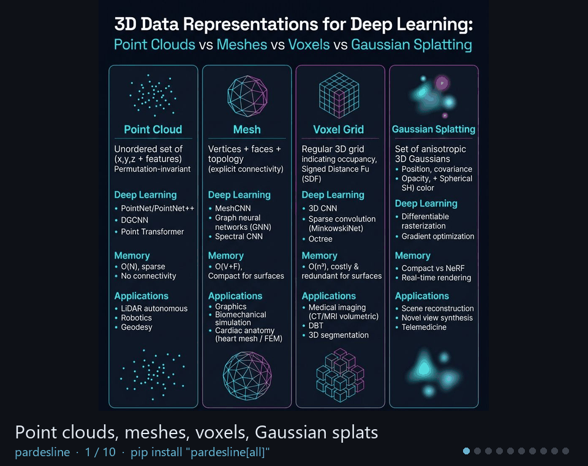

# 3D computer vision and medical imaging in Python

**pardesline** loads 43 public 3D and medical imaging datasets in one line (Medical Segmentation Decathlon, TCIA, TotalSegmentator, AMOS, LUNA16, IXI, KITTI, Objaverse, Hugging Face repos), gives you one typed object for point clouds, meshes, volumes and label maps over Open3D, PyVista and SimpleITK, runs 73 algorithms whose defaults are documented and tied to the data, and exposes everything to AI agents through a local MCP server.

<p align="center">
  <a href="showcase/"></a>
</p>

```bash
pip install "pardesline[all]"
```

```python
import pardesline as pl

s = pl.load("rire_brain")[0]  # CT + MR T1 of one head, 19 MB, licence printed
moved = s.ct.align(s.mr_t1)  # rigid registration, SimpleITK, catalog defaults
moved.save("mr_on_ct.nii.gz")  # + a sidecar with frame, licence, every parameter
moved.to_pyvista().plot()  # or .to_sitk(), .to_open3d()
```

<div class="grid cards" markdown>

-   :material-database:{ .lg .middle } **Datasets in one line**

    ---

    43 manifests over S3, Zenodo, TCIA, OpenNeuro and the Hugging Face Hub. Lazy, verified, cached; licence and citation attached; archives read by HTTP Range.

    [:octicons-arrow-right-24: Datasets catalog](datasets/index.md)

-   :material-cube-outline:{ .lg .middle } **Algorithms with defaults that work**

    ---

    Registration, reconstruction, segmentation, LiDAR, SDF, mesh and volume processing. Every default has a written reason and a validation regime.

    [:octicons-arrow-right-24: Why our defaults work](algorithms/why-our-defaults-work.md)

-   :material-brain:{ .lg .middle } **Models**

    ---

    PointNet, DINOv3 features, 3D JEPA, VAE anomaly detection, nnU-Net preparation as reference scripts; one-line pretrained access on the roadmap.

    [:octicons-arrow-right-24: Models](models/index.md)

-   :material-robot:{ .lg .middle } **For AI agents**

    ---

    `pardesline mcp` exposes datasets, algorithms and twenty expert guides as MCP tools for Claude, Cursor, Gemini CLI and Codex.

    [:octicons-arrow-right-24: MCP server](agents/mcp.md)

</div>

## Start here

| If you want to… | Read |
|---|---|
| install and run the first example in five minutes | [Install](getting-started/install.md), [5-minute tutorial](getting-started/tutorial.md) |
| understand datasets, manifests, objects and the catalog | [Concepts](getting-started/concepts.md) |
| download a specific dataset | [Datasets catalog](datasets/index.md), one page per dataset |
| fix a registration that does not converge | [Fix ICP that does not converge](how-to/fix-icp-that-does-not-converge.md) |
| see what the package does on real data | [Examples](examples.md), twelve executed scripts with images |
| compare with Open3D, PyVista, SimpleITK, MONAI, TorchIO | [Comparison](comparison.md) |
| add a dataset, an algorithm or a model manifest | [Contributing](contributing.md) |

## Measured, not claimed

- The README demo (RIRE CT/MR registration) runs cold in 21 s on a laptop: 7.6 s download, 8.8 s registration.
- On the Stanford bunny with a 35° offset, 70 % overlap and 0.5 % noise, textbook Open3D ICP ends 32.0° off with a 0.98 fitness; `target.align(moving)` ends 0.14° off. [The experiment](examples.md#icp_registration_bunny), [the numbers](https://github.com/pardesline/pardesline/blob/main/examples/icp_registration_bunny/result.json).
- 466 tests on Linux, macOS and Windows, Python 3.10 to 3.13.

<sub>Apache-2.0. Built on Open3D, PyVista, VTK, SimpleITK, NumPy, SciPy and the MCP Python SDK. Datasets keep their own licences; every manifest prints them.</sub>
