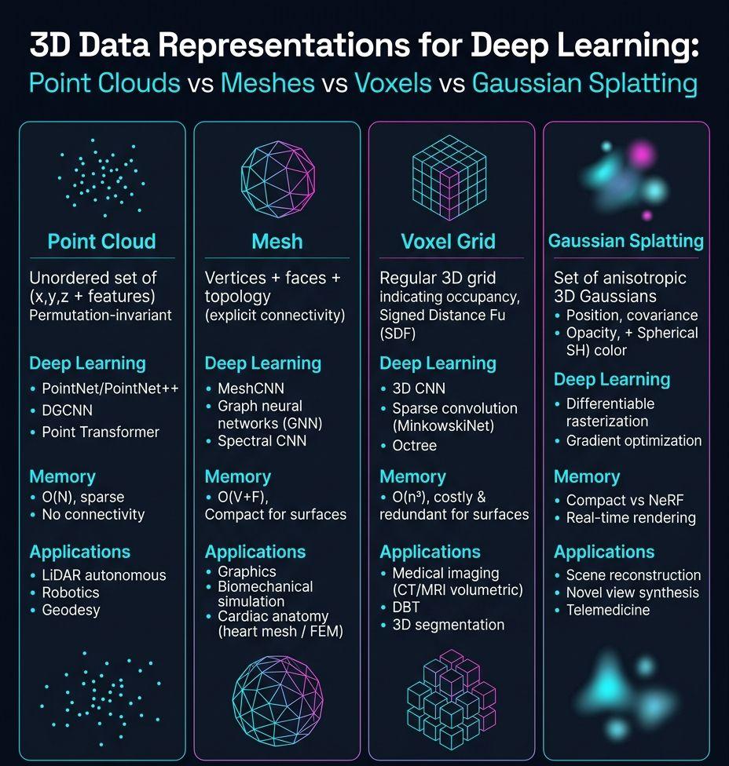
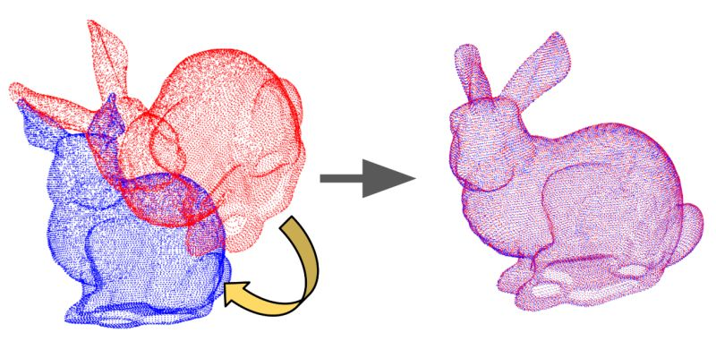
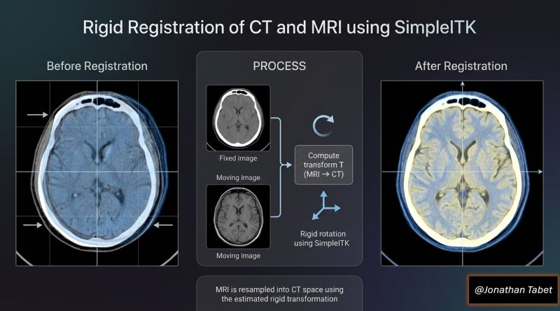
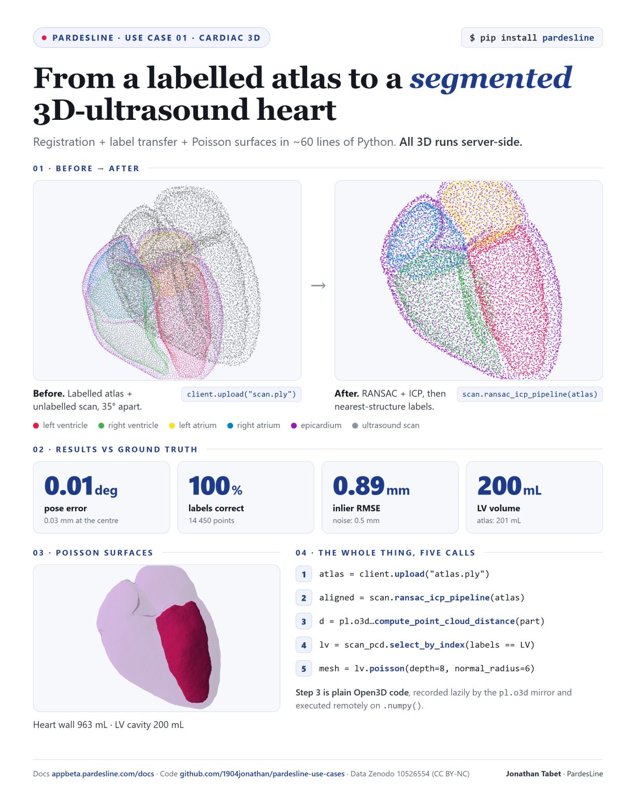
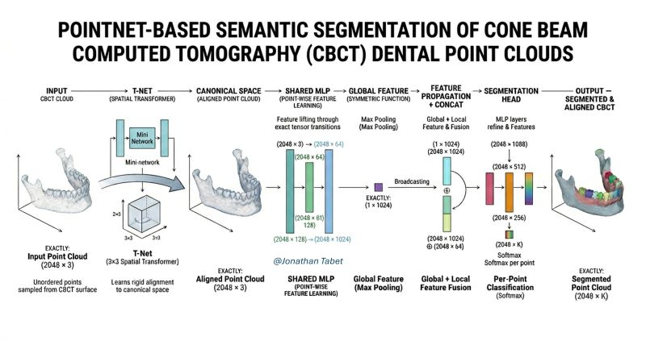
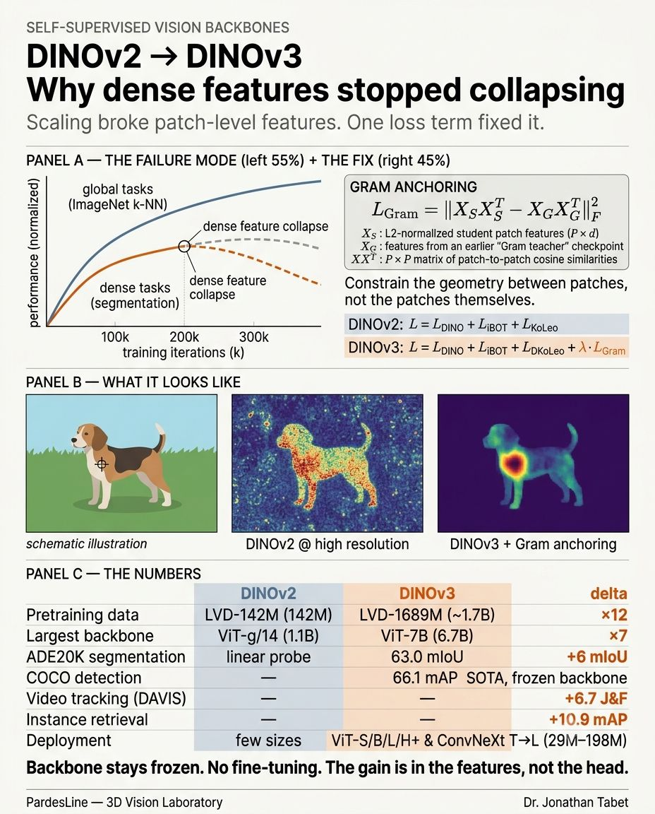
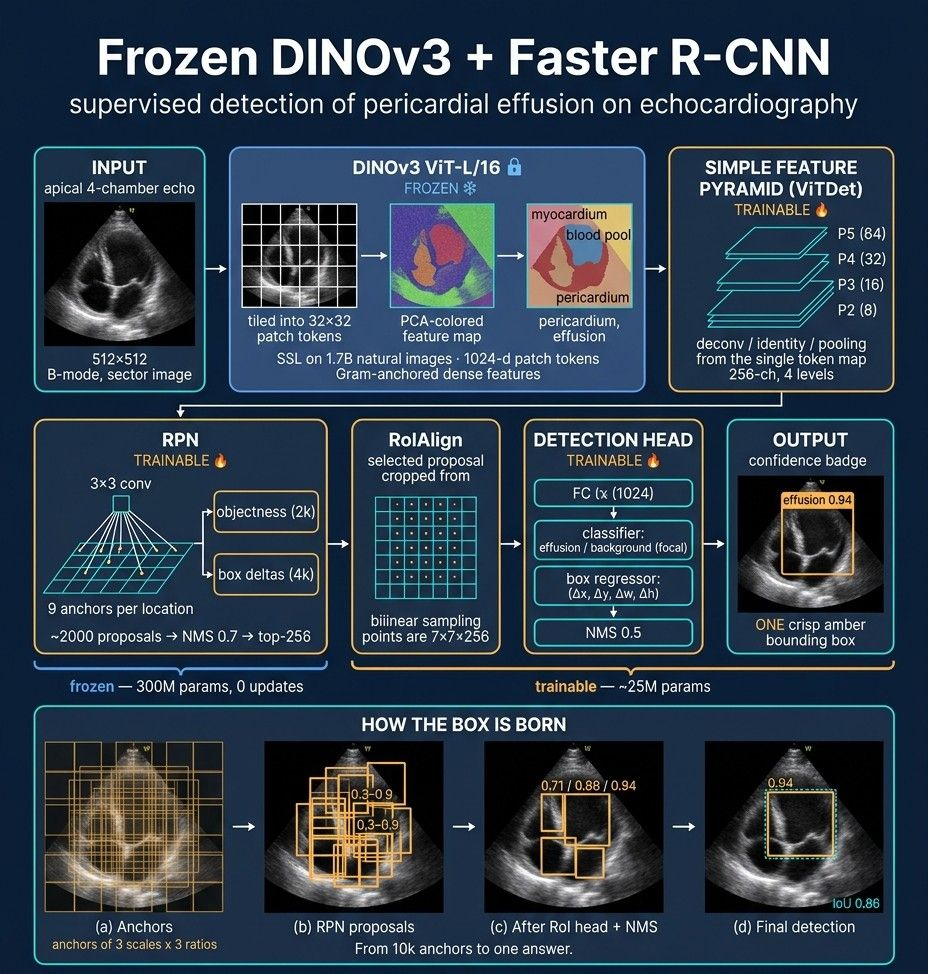
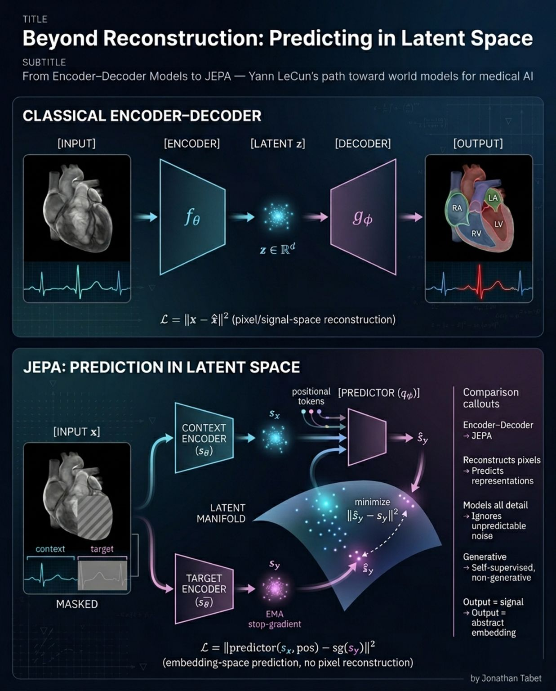
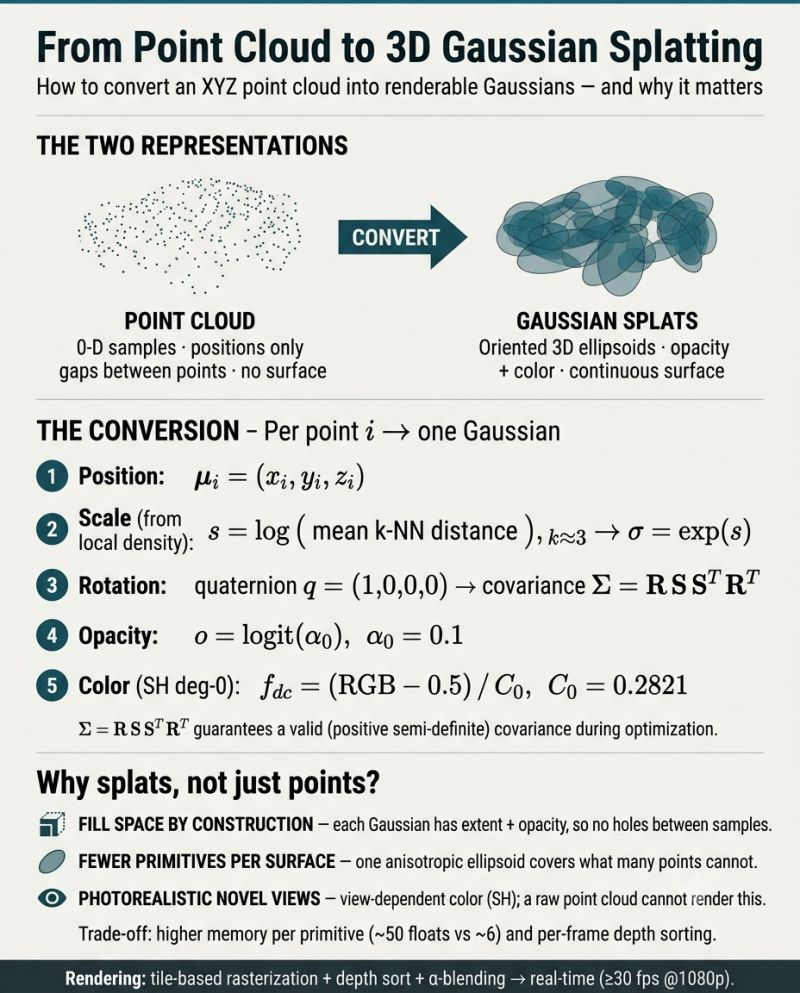
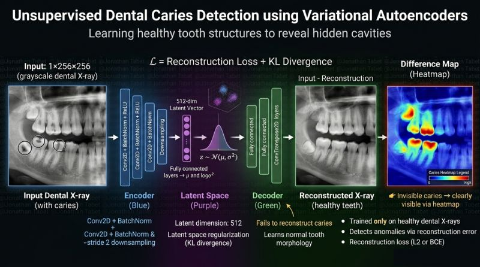

# Showcase: ten pipelines, one package

Each poster below is a real pipeline from PardesLine's work on 3D vision and
medical imaging. Under every poster: what it does, the one-line way to run
it with `pardesline`, the expert skill that explains it in depth, and the MCP
tool an AI agent calls to get there. Everything runs on your machine with
`pip install "pardesline[all]"`; nothing needs an account.

Three ways to use any of them:

| You are | Do this |
|---|---|
| a Python developer | `import pardesline as pl`, copy the snippet, run it |
| an AI agent (Claude, Gemini, Cursor, Codex) | `pardesline mcp`, then `get_skill("<skill>")` and the tools named below |
| a reader | the skill's `SKILL.md` is the written version of the poster, with the formulas and the failure modes |

---

## 1. Point clouds, meshes, voxels, Gaussian splats: which representation?



The representation decides memory, architecture and what is possible: points
for LiDAR and scanners, meshes for surfaces and biomechanics, voxels for CT and
MRI, splats for photorealistic rendering. `pardesline` keeps one typed object
per kind and converts between them only where the conversion is well posed,
recording every step.

```python
import pardesline as pl

mask = pl.load("msd_task02_heart").filter(split="Tr")[0].mask  # label map, LPS mm
surface = mask.to_mesh(label=1)  # exact boundary
points = surface.to_points(num_points=4096)  # for a point network
field = surface.run("sdf.compute_sdf", voxel_size=1.0)  # implicit field
```

Skill: [`3d-representations`](../../skills/3d-representations/SKILL.md) (conversion matrix, memory arithmetic, pitfalls).
MCP: `get_skill("3d-representations")`, `to_mesh`, `run_method`.

---

## 2. RANSAC + ICP point-cloud registration



Global alignment on FPFH features with RANSAC, refinement with point-to-plane
ICP, every parameter derived from one voxel size. The same pipeline that
aligns LiDAR sweeps aligns an atlas onto a patient scan.

```python
fixed = pl.load("scan.ply").with_frame("sensor", "mm")
moving = pl.load("atlas.ply").with_frame("sensor", "mm")
aligned = fixed.align(moving)  # registration.ransac_icp_pipeline
aligned.transform["fitness"], aligned.transform["inlier_rmse"]
```

Verified: `scripts/registration_eval.py` recovers a 35° synthetic transform on
the bunny with 0.05° error.
Skill: [`point-cloud-registration`](../../skills/point-cloud-registration/SKILL.md).
MCP: `run_method("registration.ransac_icp_pipeline", input_path, moving_path=...)`.

---

## 3. Rigid CT / MRI registration with SimpleITK



Two modalities with unrelated intensities need an information-theoretic metric:
Mattes mutual information, a centred Euler transform, gradient descent with
physical-shift scales and a multi-resolution pyramid. The result is validated
by target registration error, never by the metric value alone.

```python
s = pl.load("rire_brain")[0]  # CT + MR-T1 of one brain
moved = s.ct.align(s.mr_t1, metric="mattes_mutual_information", num_iterations=200)
moved.transform["rotation_deg"], moved.transform["translation_mm"]
```

Verified: `scripts/rigid_ct_mr.py` on the RIRE pair (3.9° rotation found, metric trace, checkerboard).
Skill: [`multimodal-rigid-registration`](../../skills/multimodal-rigid-registration/SKILL.md).
MCP: `load_sample("rire_brain", "training_001", "ct")`, `run_method("simpleitk_registration.rigid", ...)`.

---

## 4. From a labelled atlas to a segmented 3D-ultrasound heart



Register the atlas onto the scan, give every scan point the label of its
nearest anatomical structure, reconstruct each chamber with Poisson, measure
volumes in millilitres, evaluate against the truth.

```python
aligned = scan.align(atlas)  # atlas moves, point order kept
# nearest-structure labels, per-label Poisson surfaces, volumes: scripts/atlas_label_transfer.py
```

Verified: 99.2 % label agreement and 0.04° pose error on a synthetic scan.
Skill: [`atlas-label-transfer`](../../skills/atlas-label-transfer/SKILL.md).
MCP: `get_skill("atlas-label-transfer", "scripts/atlas_label_transfer.py")`.

---

## 5. PointNet segmentation of CBCT point clouds



T-Net alignment, shared MLP, max-pool global feature, local + global
concatenation, per-point softmax: the whole network, tensor by tensor, plus
the data contract and how to build labelled clouds from any label map.

```python
# label maps -> labelled clouds (.npz, unit sphere, normals, class table)
# python skills/pointnet-segmentation/scripts/make_point_dataset.py msd_task04_hippocampus --out ./hippo --take 20
# python skills/pointnet-segmentation/scripts/pointnet_seg.py train --data ./hippo --out ./runs/hippo
```

Skill: [`pointnet-segmentation`](../../skills/pointnet-segmentation/SKILL.md).
MCP: `list_samples("msd_task04_hippocampus")`, `load_sample(..., "mask")`, `get_skill("pointnet-segmentation", "scripts/pointnet_seg.py")`.

---

## 6. DINOv2 to DINOv3: why dense features stopped collapsing



Scaling broke patch-level features; one loss on the Gram matrix of patch
similarities fixed it. Clean dense features at high resolution are the
primitive geometric tasks are built on, and a frozen backbone is now a
production design.

```bash
python skills/dinov3-dense-features/scripts/dinov3_features.py ./frames --out ./feats --size 512   # patch tokens + PCA maps
```

Skill: [`dinov3-dense-features`](../../skills/dinov3-dense-features/SKILL.md).
MCP: `get_skill("dinov3-dense-features")`.

---

## 7. Frozen DINOv3 + Faster R-CNN on echocardiography



A backbone that never saw an ultrasound already separates myocardium, blood
pool and pericardium; a 25 M-parameter head learns to name what it sees.
ViTDet simple feature pyramid, RPN, RoIAlign, box head, NMS.

```bash
python skills/dinov3-dense-features/scripts/dinov3_faster_rcnn.py train --images ./echo --ann train.json --val-ann val.json --out ./runs/effusion
```

Skill: [`dinov3-dense-features`](../../skills/dinov3-dense-features/SKILL.md) (section "Heads on a frozen backbone").
MCP: `get_skill("dinov3-dense-features", "scripts/dinov3_faster_rcnn.py")`.

---

## 8. Beyond reconstruction: JEPA predicts in latent space



No decoder, no pixel reconstruction: a context encoder, an EMA target encoder
and a predictor that learns only what is predictable - anatomy, not noise.
The 3D reference trainer tokenises volumes from any `pardesline` dataset.

```bash
python skills/jepa-pretraining/scripts/jepa3d_pretrain.py --dataset totalsegmentator_ct --role ct --take 200 --crop 96
python skills/jepa-pretraining/scripts/jepa3d_pretrain.py --smoke        # CPU, seconds
```

Skill: [`jepa-pretraining`](../../skills/jepa-pretraining/SKILL.md).
MCP: `list_datasets(medical_only=true)`, `get_skill("jepa-pretraining")`.

---

## 9. From a point cloud to 3D Gaussian splats



Position, k-NN scale, identity rotation, logit opacity, SH degree-0 colour:
five steps per point, a covariance that stays valid, a PLY that any 3DGS
viewer opens.

```bash
python skills/gaussian-splatting/scripts/points_to_gaussians.py open3d_bunny bunny_splat.ply --colour 0.8 0.7 0.6
```

Verified: 100 000 Gaussians written and read back (24.8 MB, 62 floats each).
Skill: [`gaussian-splatting`](../../skills/gaussian-splatting/SKILL.md); datasets `c3vd_endoscopy_splats`, `hf_3d_arena`, `hf_kitti360_gs_subset`.
MCP: `load_sample("c3vd_endoscopy_splats", 0, "splat")`.

---

## 10. Unsupervised caries detection with a variational autoencoder



A model trained only on healthy teeth cannot reconstruct a cavity; the
residual map exposes it. Reconstruction + KL with beta warm-up, residual
smoothing, thresholds from normal validation data, AUROC / AUPRC.

```bash
python skills/vae-anomaly-detection/scripts/vae_anomaly.py train --normal ./healthy --out ./runs/vae
python skills/vae-anomaly-detection/scripts/vae_anomaly.py score --weights ./runs/vae/vae.pt --images ./test --out ./scores
```

Skill: [`vae-anomaly-detection`](../../skills/vae-anomaly-detection/SKILL.md).
MCP: `get_skill("vae-anomaly-detection")`.

---

## The common ground

- **Data**: 43 datasets load in one line (`pl.load("msd_task02_heart")`,
  `pl.load("tcia://Pancreas-CT")`, `pl.load("hf://org/name")`), licence
  attached, nothing downloaded until you touch a sample.
- **Objects**: a `PointCloud`, `Mesh`, `Volume` or `LabelMap` knows its frame,
  units, labels, licence and provenance; conversions are exact or say they are
  not.
- **Algorithms**: 73, validated parameters, local or on the hosted GPU with the
  same names.
- **Libraries**: Open3D, SimpleITK, PyVista are one call away
  (`obj.to_open3d()`, `obj.to_sitk()`, `obj.to_pyvista()`).
- **Agents**: `pardesline mcp` gives all of it, plus these skills, to any MCP
  client without an account.
- **Metrics**: [`evaluation-metrics-3d`](../../skills/evaluation-metrics-3d/SKILL.md) says which number to report and how.

Posters by Jonathan Tabet, PardesLine. The images are part of the repository
documentation under the project licence.
