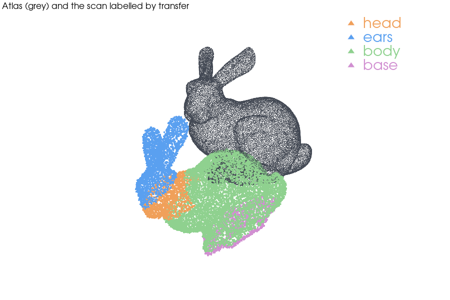

# Atlas label transfer on the Stanford bunny: register a labelled atlas, transfer labels, evaluate

| | |
|---|---|
| Dataset | `open3d_bunny` |
| What it shows | Labelled atlas registered onto a noisy rotated copy; label agreement 99.4 %, pose error 0.06°. |
| Extra dependencies | none beyond `pardesline[all]` |
| Cold runtime (Windows laptop, CPU) | 1 min |

Runs the reference script of the ``atlas-label-transfer`` skill. The bunny
(Open3D data) is the atlas, labelled into head / ears / body / base; the
"scan" is a rotated, noisy, sub-sampled copy with a known transform, so the
label agreement after RANSAC + ICP registration and nearest-structure transfer
is measured exactly.

```bash
pip install "pardesline[local]"
python examples/atlas_label_transfer_bunny/run.py       # writes ./out/ with the labelled scan and a JSON report
```



Outputs are written next to this file; `result.json` and the images are committed, large files are ignored. See [`examples/README.md`](../README.md) for the full gallery.
