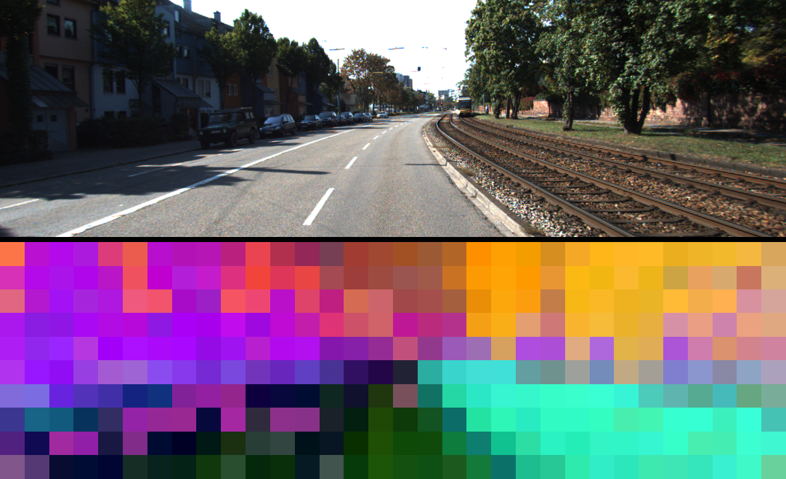

# Dense DINOv2 patch features on a KITTI camera frame (DINOv3 with the gated weights)

| | |
|---|---|
| Dataset | `kitti_raw_2011_09_26_drive_0001` |
| What it shows | Frozen DINOv2-small patch features on a camera frame, PCA-coloured; swap in DINOv3 after accepting its licence. |
| Extra dependencies | torch, transformers |
| Cold runtime (Windows laptop, CPU) | 1 min + 90 MB weights |

One left-camera frame is read out of the KITTI raw zip by HTTP Range and
``dinov3_features.py`` from the ``dinov3-dense-features`` skill extracts the
patch features of a frozen backbone and colours them by PCA. ``facebook/dinov2-small``
is used here because it downloads without an agreement; pass
``--model facebook/dinov3-vits16-pretrain-lvd1689m`` after accepting the licence on the Hub.

```bash
pip install "pardesline[local]" torch transformers pillow
python examples/dinov2_features_kitti/run.py            # writes feats/<frame>_pca.png
```



Outputs are written next to this file; `result.json` and the images are committed, large files are ignored. See [`examples/README.md`](../README.md) for the full gallery.
