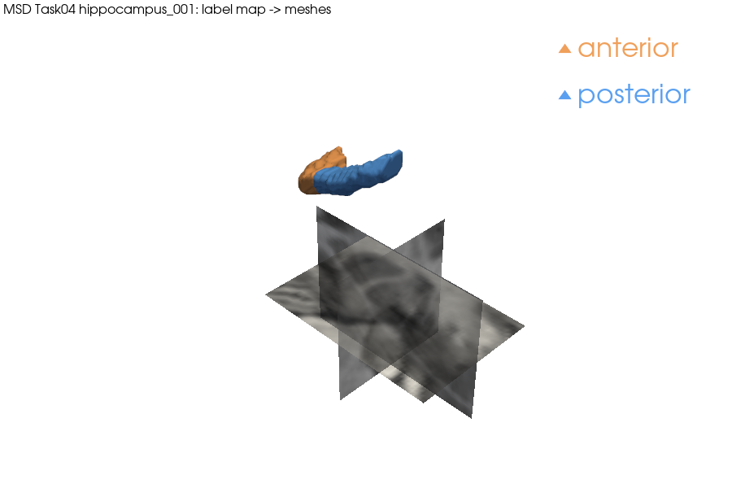

# Segmentation mask to surface mesh on the Medical Segmentation Decathlon hippocampus task

| | |
|---|---|
| Dataset | `msd_task04_hippocampus` (28 MB) |
| What it shows | Label map to exact surfaces (anterior, posterior), Taubin smoothing, STL + sidecar, render over MRI slices. |
| Extra dependencies | none beyond `pardesline[all]` |
| Cold runtime (Windows laptop, CPU) | 15 s (+ one-time archive download) |

The first labelled case is fetched from the official MSD tar (28 MB, read by
HTTP Range; the first run indexes the archive). The label map knows its
labels (1 = anterior, 2 = posterior) from the manifest, so ``to_mesh(label=1)``
is the exact boundary of the anterior hippocampus in LPS millimetres. Taubin
smoothing (catalog defaults) removes the voxel staircase, the STL is written
with a sidecar that records the frame, the licence and both steps.

```bash
pip install "pardesline[all]"
python examples/hippocampus_mask_to_mesh/run.py        # writes hippocampus.png and hippocampus_anterior.stl
```



Outputs are written next to this file; `result.json` and the images are committed, large files are ignored. See [`examples/README.md`](../README.md) for the full gallery.
