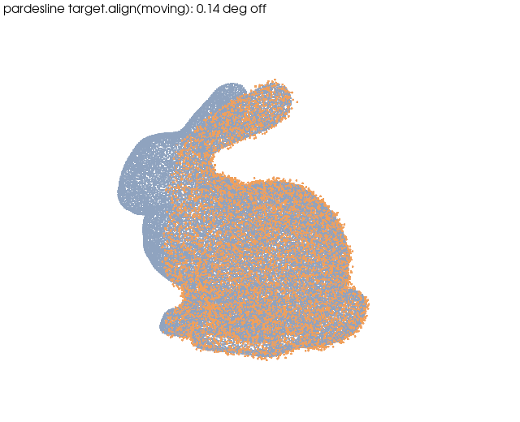
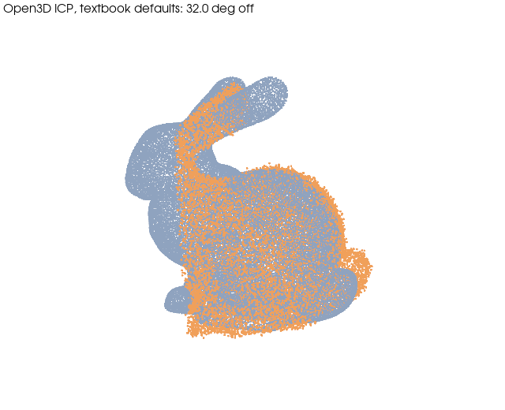

# RANSAC + ICP registration on the Stanford bunny: textbook ICP vs pardesline defaults

| | |
|---|---|
| Dataset | `open3d_bunny` (3 MB) |
| What it shows | Textbook Open3D ICP vs `target.align(moving)` on a 35°, 70 %-overlap, noisy copy: 32.0° vs 0.14° residual (RANSAC is randomised: expect a few hundredths of a degree of spread). Writes `result.json`. |
| Extra dependencies | none beyond `pardesline[all]` |
| Cold runtime (Windows laptop, CPU) | 40 s |

The bunny mesh (Open3D data) is sampled into a point cloud. A "moving" copy is
rotated by 35 degrees, translated, trimmed to 70 % overlap and jittered with
0.5 % noise, the way a second scan of a part looks. Both approaches get the
same two clouds:

* textbook: Open3D ``registration_icp`` from the identity with the tutorial's
  constant threshold, point-to-point, 30 iterations (Open3D's defaults);
* pardesline: ``target.align(moving)`` = ``registration.ransac_icp_pipeline``
  with the catalog defaults (voxel size from the bounding box, FPFH + RANSAC,
  then point-to-plane ICP at a distance tied to the voxel size).

The rotation error against the known transform is printed for both.

```bash
pip install "pardesline[local]"
python examples/icp_registration_bunny/run.py        # writes two PNGs and a JSON next to this file
```





Outputs are written next to this file; `result.json` and the images are committed, large files are ignored. See [`examples/README.md`](../README.md) for the full gallery.
