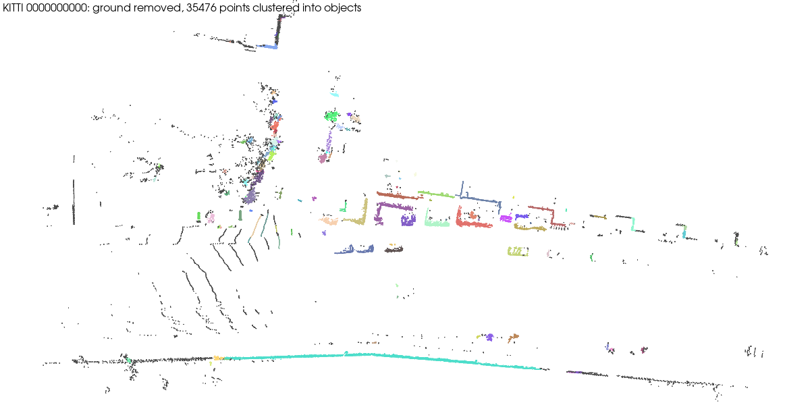

# Ground removal and object clustering on one KITTI Velodyne sweep

| | |
|---|---|
| Dataset | `kitti_raw_2011_09_26_drive_0001` (one 2 MB sweep) |
| What it shows | Raw `(N, 4)` binary read through the manifest layout, ground RANSAC, DBSCAN objects. |
| Extra dependencies | none beyond `pardesline[all]` |
| Cold runtime (Windows laptop, CPU) | 20 s |

One sweep (2 MB) is read out of the official 459 MB KITTI raw zip by HTTP
Range; the manifest's layout turns the headerless float32 (N, 4) file into a
point cloud in the sensor frame (metres). ``lidar_scene_detection.object_clustering``
at the catalog defaults removes the ground plane by RANSAC (0.3 m) and clusters
the rest with DBSCAN (0.5 m, 10 points): each colour is one object.

```bash
pip install "pardesline[local]"
python examples/kitti_lidar_ground_and_objects/run.py     # writes kitti_objects.png
```



Outputs are written next to this file; `result.json` and the images are committed, large files are ignored. See [`examples/README.md`](../README.md) for the full gallery.
