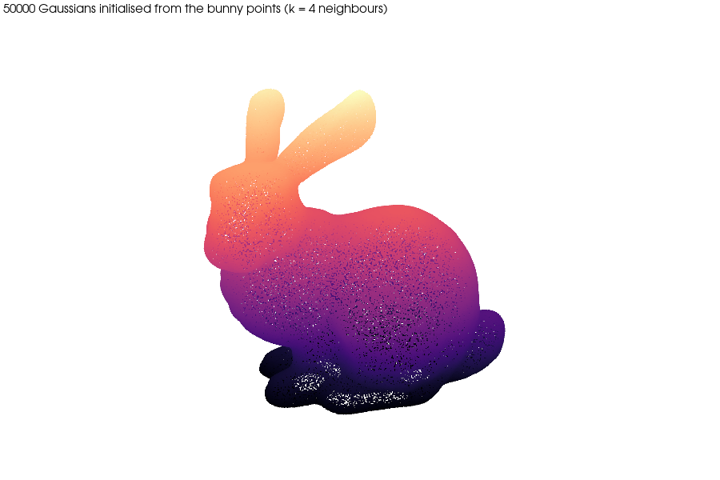

# Point cloud to 3D Gaussian splats on the Stanford bunny

| | |
|---|---|
| Dataset | `open3d_bunny` |
| What it shows | 50 000 points to a 3DGS-compatible PLY (12 MB) that opens in gsplat / Nerfstudio viewers. |
| Extra dependencies | SciPy |
| Cold runtime (Windows laptop, CPU) | 20 s |

Runs the reference script of the ``gaussian-splatting`` skill: the bunny
mesh is sampled into points, each point becomes a Gaussian (scale from the
k-nearest-neighbour distance, identity rotation, SH degree-0 colour) and the
result is written as a 3DGS-compatible PLY.

```bash
pip install "pardesline[local]"
python examples/points_to_gaussians_bunny/run.py        # writes bunny_splats.ply (opens in gsplat, Nerfstudio and the Hugging Face viewers)
```



Outputs are written next to this file; `result.json` and the images are committed, large files are ignored. See [`examples/README.md`](../README.md) for the full gallery.
