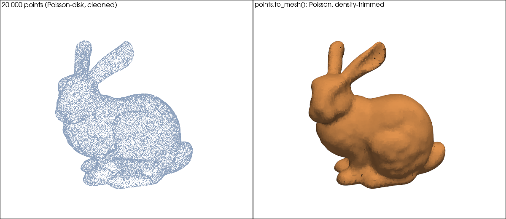

# Poisson surface reconstruction of the Stanford bunny from a sampled point cloud

| | |
|---|---|
| Dataset | `open3d_bunny` |
| What it shows | Mesh to 20 000 points, outlier removal, Poisson surface at the catalog defaults. |
| Extra dependencies | none beyond `pardesline[all]` |
| Cold runtime (Windows laptop, CPU) | 30 s |

The bunny mesh (Open3D data) is sampled into 20 000 points (Poisson-disk),
the points are cleaned (statistical outlier removal) and a surface is rebuilt
with ``to_mesh()`` = ``point_cloud_reconstruction.poisson`` at the catalog
defaults (octree depth 9, density-trimmed at the 1 % quantile so the surface
does not balloon where there are no points). The result is a clean surface,
not a closed one: Poisson is lossy and parametric, and the sidecar says so.

```bash
pip install "pardesline[local]"
python examples/poisson_reconstruction_bunny/run.py      # writes bunny_poisson.png and bunny_poisson.ply
```



Outputs are written next to this file; `result.json` and the images are committed, large files are ignored. See [`examples/README.md`](../README.md) for the full gallery.
