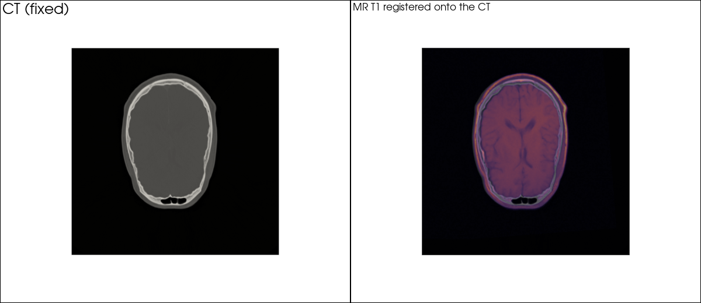

# Rigid CT / MR registration on the RIRE brain pair, the README 30-second demo

| | |
|---|---|
| Dataset | `rire_brain` (19 MB) |
| What it shows | SimpleITK rigid registration, CT fixed / MR moving, two-panel render. The README demo. |
| Extra dependencies | none beyond `pardesline[all]` |
| Cold runtime (Windows laptop, CPU) | 21 s |

Loads the RIRE training_001 CT and MR-T1 (19 MB, two files, checksummed),
registers the MR onto the CT (SimpleITK rigid, Mattes mutual information,
geometry-centred initialisation: the catalog defaults) and renders the CT
slice before and after the MR overlay.

```bash
pip install "pardesline[all]"
python examples/register_ct_mr_rire/run.py            # writes rire_ct_mr.png next to this file
```



Outputs are written next to this file; `result.json` and the images are committed, large files are ignored. See [`examples/README.md`](../README.md) for the full gallery.
