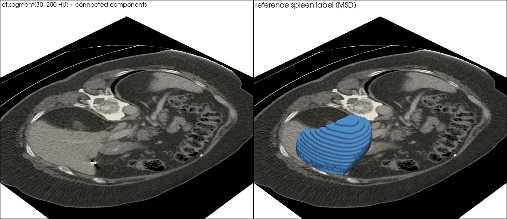

# Threshold segmentation of a CT from the Medical Segmentation Decathlon spleen task

| | |
|---|---|
| Dataset | `msd_task09_spleen` (one 30 MB CT out of 1.6 GB) |
| What it shows | `segment(30, 200 HU)` + connected components vs the expert label: the baseline a model must beat. |
| Extra dependencies | none beyond `pardesline[all]` |
| Cold runtime (Windows laptop, CPU) | 1–2 min (tar index + one volume) |

One portal-venous CT (about 30 MB) is fetched out of the official 1.6 GB MSD
tar by HTTP Range. ``segment(lower, upper)`` thresholds in Hounsfield units
(soft tissue window 30..200 HU), then the largest connected component is kept
and turned into a surface. The reference spleen mask of the dataset is drawn
next to it so the gap between a threshold and an expert label is visible:
this is the honest baseline a learned model has to beat.

```bash
pip install "pardesline[all]"
python examples/spleen_ct_threshold_segmentation/run.py    # writes spleen_ct.png
```



Outputs are written next to this file; `result.json` and the images are committed, large files are ignored. See [`examples/README.md`](../README.md) for the full gallery.
