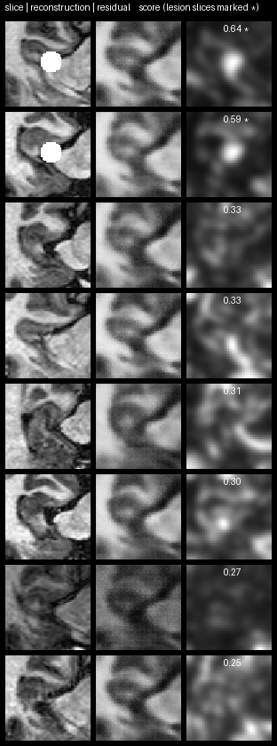

# VAE reconstruction-based anomaly detection on hippocampus MRI slices

| | |
|---|---|
| Dataset | `msd_task04_hippocampus` |
| What it shows | VAE trained on 24 normal mid-slices, 8 held-out slices scored: the 2 with a synthetic lesion score 0.59 and 0.64, the normals at most 0.33. Writes a contact sheet. |
| Extra dependencies | torch, pillow |
| Cold runtime (Windows laptop, CPU) | 2 min |

Mid-axial slices of the first 24 MSD hippocampus MRIs are written as PNG
(the "normal" set); ``vae_anomaly.py`` from the ``vae-anomaly-detection``
skill trains a small VAE on them and scores eight held-out slices, two of
which carry a synthetic bright lesion. Scores and residual heat-maps land in
./scores.

```bash
pip install "pardesline[all]" torch pillow
python examples/vae_anomaly_hippocampus/run.py          # a few minutes on CPU
```



Outputs are written next to this file; `result.json` and the images are committed, large files are ignored. See [`examples/README.md`](../README.md) for the full gallery.
